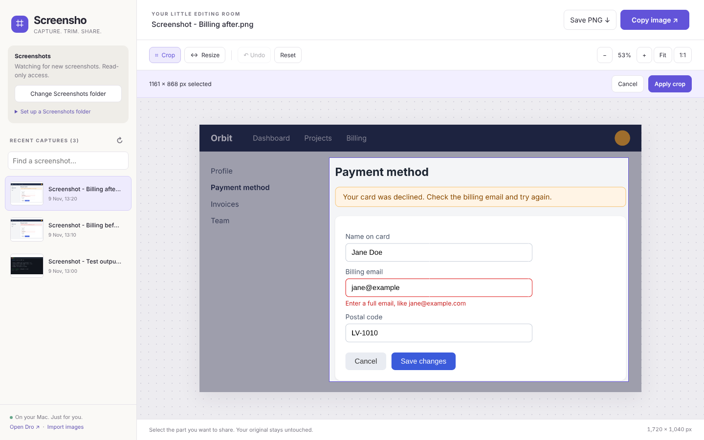

# Screensho

A small, personal screenshot editor in one HTML file. Pick a capture, crop or resize it, then copy it into a chat or Dro.

**[Try now in your browser →](https://airokz.github.io/Screensho/)** · [Download `index.html`](index.html) · Open in Chrome and bookmark with Cmd+D.



## Use it

Use the [live version](https://airokz.github.io/Screensho/) (the same file, still with no outgoing requests once loaded), or download `index.html` and open it in a desktop browser. That is the whole application, including its logo and favicon. No install, build step, server, account, or internet connection is required.

- Choose your **Screenshots folder**. The latest 100 images appear in the sidebar, newest first, and refresh while the page is visible.
- Crop by dragging over the image in either direction, then click **Apply crop**.
- Resize to exact pixel dimensions, with proportions locked by default.
- Zoom, fit, and view at 1:1 without changing the output size.
- Undo edits, reset to the original, or download a separate PNG.
- Click **Copy image**, then paste the PNG into a chat or Dro with Cmd/Ctrl+V.
- Import images with **Open images**, file drag-and-drop, or Cmd/Ctrl+V.

New screenshots appear at the top without interrupting the current edit. **Open Dro** opens the sibling local checkout when running from a file, or Dro's browser demo when Screensho is hosted.

### Choose a Screenshots folder

Live folder access uses the browser's File System Access API:

| Browser                           | Live Screenshots folder                                                     |
| --------------------------------- | --------------------------------------------------------------------------- |
| Chrome, Edge, Opera, Vivaldi, Arc | Yes                                                                         |
| Brave                             | Off by default; enable `brave://flags/#file-system-access-api` and relaunch |
| Firefox, Safari                   | No; use **Open images**, drag-and-drop, or paste instead                    |

**Desktop, Documents, Downloads, and your home folder can't be connected** in any of these browsers. Picking one shows the browser's own _"Can't open this folder because it contains system files"_ dialog. Folders _inside_ them work, so connect a dedicated **Screenshots** subfolder instead. This is a browser security rule, not a macOS or Windows permission you can turn off; see [Chromium's blocked folders](https://chromium.googlesource.com/chromium/src.git/+/7917bc533702fc1e437398610f63563630955292/chrome/browser/file_system_access/chrome_file_system_access_permission_context.cc#304). Choosing individual files with **Open images** is never blocked.

#### macOS

macOS saves screenshots to the Desktop by default, so they need a new folder:

1. In Finder, create a folder named **Screenshots**, for example inside Desktop or Pictures.
2. Press **Cmd+Shift+5**, open **Options → Other Location…**, and choose that folder. This also applies to captures taken with Cmd+Shift+3 and Cmd+Shift+4.
3. In Screensho, click **Choose Screenshots folder** and select that folder.
4. Move existing captures into it in Finder if you want them listed, or open them individually with **Open images**.

#### Windows

Windows already saves screenshots to a subfolder, so there is usually nothing to set up:

1. **Win+PrtScn** and Snipping Tool (Win+Shift+S, with automatic saving on) save to **Pictures\Screenshots**. If OneDrive backs up your Pictures folder, it is **OneDrive\Pictures\Screenshots**.
2. In Screensho, click **Choose Screenshots folder** and select that folder.
3. If you save screenshots to the Desktop or Downloads, create a **Screenshots** folder inside it and save there instead.

Screensho requests read access only. It remembers the folder in browser storage, but Chrome may require **Reconnect Screenshots folder** after reopening or when permissions expire. Screensho does not change your system's screenshot settings or move existing captures automatically.

## Shortcuts

| Key                    | Action                      |
| ---------------------- | --------------------------- |
| Cmd/Ctrl+C             | Copy edited PNG             |
| Cmd/Ctrl+V             | Import image from clipboard |
| Cmd/Ctrl+Z             | Undo                        |
| Escape                 | Cancel crop selection       |
| Cmd/Ctrl + mouse wheel | Zoom                        |

## Your files and privacy

Screensho has no analytics, accounts, remote fonts, or outgoing network requests. A Content-Security-Policy in `index.html` makes the browser block any network request, so this does not rely on trust: you can check it in the page source. Your images stay in browser memory, browser storage, and files you choose to save. This repository contains application code and fictional example artwork, not your screenshots.

**Copy or download important edits.** Edits are held in memory and are not restored after closing. Switching images asks before discarding edits; closing an edited page triggers the browser's unsaved-work prompt. Folder permission is a best-effort saved preference and can be cleared or tied to the HTML location. Saving downloads a new `-screensho.png` file; it never overwrites the original.

The connected folder includes PNG, JPEG, WebP, GIF, AVIF, and BMP images, including renamed captures. Scanning is limited to that folder without recursion. Animated files become a still image. Images are limited to 40 megapixels and 16,384 pixels per side. Undo keeps up to eight previous edits; large images can still use substantial memory.

## Scope and browser support

Screensho is a personal desktop screenshot editor, tested in desktop Chrome on macOS. See [Choose a Screenshots folder](#choose-a-screenshots-folder) for which browsers support a live folder. Other Chromium browsers, Windows, Firefox, and Safari have not been verified.

Clipboard access depends on your browser and permissions. Screensho copies actual PNG data. If copying is blocked, allow clipboard access or download the PNG and drag it into the destination.

## Development

Edit `index.html` and reload it. The code uses the same [Prettier](https://prettier.io) settings as Dro; run `npx prettier --write index.html tests` to keep diffs readable. Keep the application self-contained: no runtime dependencies, CDN assets, bundler, or backend. Tests and documentation are not needed to run it.

Browser regression tests use Node.js, Playwright Core, and an installed Chrome browser:

```sh
npm ci
npm test
```

`CHROME_PATH` overrides the Chrome executable path. The Dro paste check uses `DRO_PATH`, or a Dro checkout next to Screensho, and is skipped when neither exists. GitHub Actions runs the tests on every push and pull request. Tests open the HTML using `file://`, generate their own image fixtures, and cover crop pixels, resize, zoom invariance, undo/reset, real PNG clipboard data, pasting into the sibling Dro checkout, download dimensions, folder ordering and refresh, renamed captures, filtering, disappearing files, safe filenames, responsive layout, and no outgoing requests. Clipboard tests temporarily replace the clipboard with a generated image. Native folder dialogs and permission restoration in your normal Chrome profile require a manual check; permission errors and picker options use test fixtures.

Run `npm run preview` to regenerate `docs/screenshot.png` from the fictional captures in `docs/examples/`. No personal screenshots are used.

### GitHub Pages

The deployment workflow follows Dro's `.github/workflows/pages.yml`: checkout, copy the single HTML into `_site`, configure Pages, upload the artifact, and deploy. Pages publishes the same application with no backend or screenshot uploads.

It publishes to [airokz.github.io/Screensho](https://airokz.github.io/Screensho/) on every push to `main` that changes `index.html` or the workflow.

## License

[Apache License 2.0](LICENSE). The standalone HTML also includes the license so it can be shared on its own. This license covers Screensho's code and bundled example artwork, not screenshots or images you open or edit.
